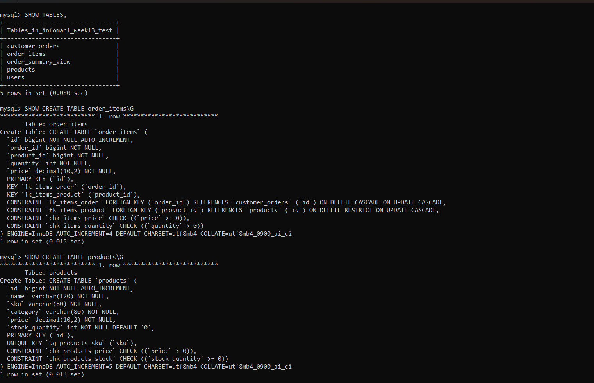
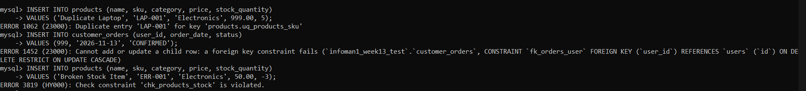
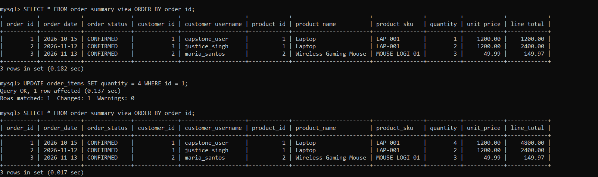
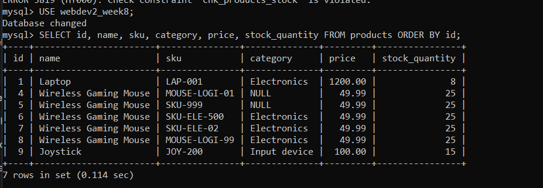
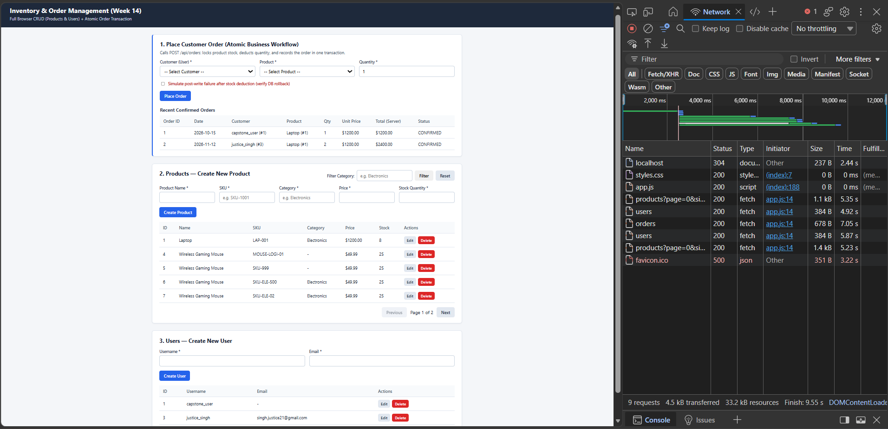

# INFOMAN1 — Week 13 Lab Answers: Connected Database Foundation and Views

Name: OBIEFULE DECLAN
Student ID: 2510223
GitHub repo: https://github.com/sochimaobiefule-ship-it/infoman1
Date submitted: 13/11/2026

---

## Task 1 — Reproducible Schema & Constraint Verification

**Approach / explanation:**  
I took the four core tables from my Inventory & Order Management capstone (`users`, `products`, `customer_orders`, `order_items`) and put them into a standalone `schema.sql` using InnoDB and parent-before-child table order. I added explicit `NOT NULL`, `UNIQUE` (`uq_users_username`, `uq_users_email`, `uq_products_sku`), `FOREIGN KEY`, and `CHECK` constraints (`chk_products_price`, `chk_products_stock`, `chk_items_quantity`, `chk_items_price`), then ran `schema.sql` and `seed.sql` inside a clean `infoman1_week13_test` database on MySQL 9.7.2.

**Code / query used (if applicable):**
```sql
mysql> SHOW TABLES;

mysql> SHOW CREATE TABLE order_items\G

mysql> SHOW CREATE TABLE products\G
```

**Evidence (screenshot filename, output, or file reference in this folder):**


---

## Task 2 — Constraint Rejection Testing (`UNIQUE`, `FK`, and `CHECK`)

**Approach / explanation:**
To prove that MySQL 9.7.2 actively enforces data integrity instead of just storing constraint names, I ran three invalid `INSERT` queries inside `infoman1_week13_test`: a duplicate product SKU (`LAP-001`), an order pointing to a non-existent `user_id` (`999`), and a product with a negative `stock_quantity` (`-3`). MySQL blocked all three right away with exact error codes.

**Code / query used (if applicable):**
```sql
mysql> INSERT INTO products (name, sku, category, price, stock_quantity)
    -> VALUES ('Duplicate Laptop', 'LAP-001', 'Electronics', 999.00, 5);

mysql> INSERT INTO customer_orders (user_id, order_date, status)
    -> VALUES (999, '2026-11-13', 'CONFIRMED');

mysql> INSERT INTO products (name, sku, category, price, stock_quantity)
    -> VALUES ('Broken Stock Item', 'ERR-001', 'Electronics', 50.00, -3);
```

**Evidence (screenshot filename, output, or file reference in this folder):**


---

## Task 3 — Live Multi-Table Reporting View (`order_summary_view`)

**Approach / explanation:**
I created `order_summary_view` in `views.sql` by joining `customer_orders`, `users`, `order_items`, and `products` and calculating `(oi.quantity * oi.price) AS line_total`. To verify that the view reads live table rows rather than acting like a static copy, I queried the view, updated `quantity` from `1` to `4` on `order_items.id = 1`, and queried the view again without recreating it.

**Code / query used (if applicable):**
```sql
mysql> SELECT * FROM order_summary_view ORDER BY order_id;

mysql> UPDATE order_items SET quantity = 4 WHERE id = 1;

mysql> SELECT * FROM order_summary_view ORDER BY order_id;
```

**Evidence (screenshot filename, output, or file reference in this folder):**


---

## Task 4 — Application-to-MySQL Read & Credential Safety

**Approach / explanation:**
I started my Spring Boot backend connected via JDBC (`mysql-connector-j`) to `webdev2_week8` and compared the products loaded on the webpage (`GET /api/products`) against a direct `SELECT` query on `products` in MySQL. Both showed the exact same rows (`Laptop` with stock `8`, `Wireless Gaming Mouse` entries with stock `25`, etc.), while MySQL login credentials stayed outside Git in local environment variables.

**Code / query used (if applicable):**
```sql
mysql> USE webdev2_week8;

mysql> SELECT id, name, sku, category, price, stock_quantity FROM products ORDER BY id;
```

**Evidence (screenshot filename, output, or file reference in this folder):**



---

## Self-Check

* [] All tasks committed with individual, meaningful commit messages
* [] All files placed inside `infoman1/week13/`
* [] Rebuilt cleanly in a dedicated test database (`infoman1_week13_test`)
* [] Repository link pasted into Moodle (no files uploaded)