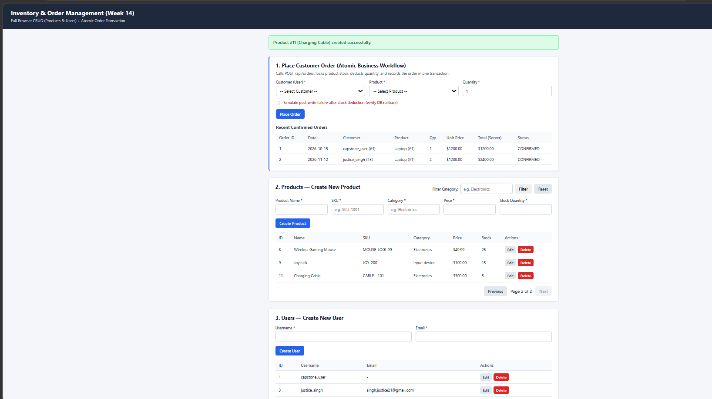
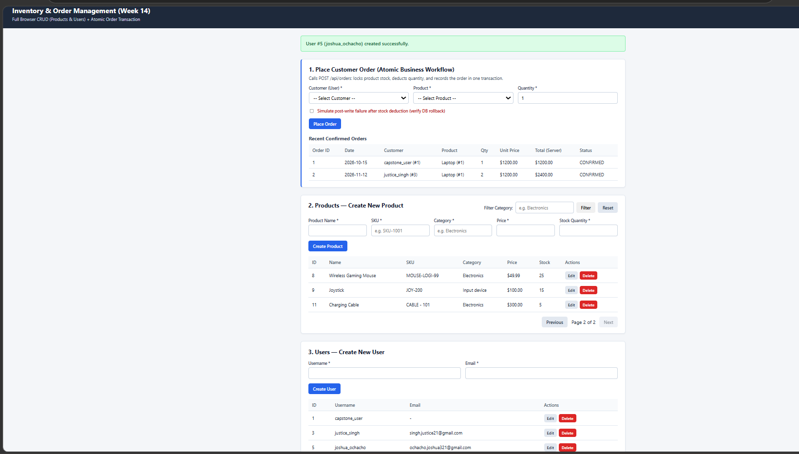
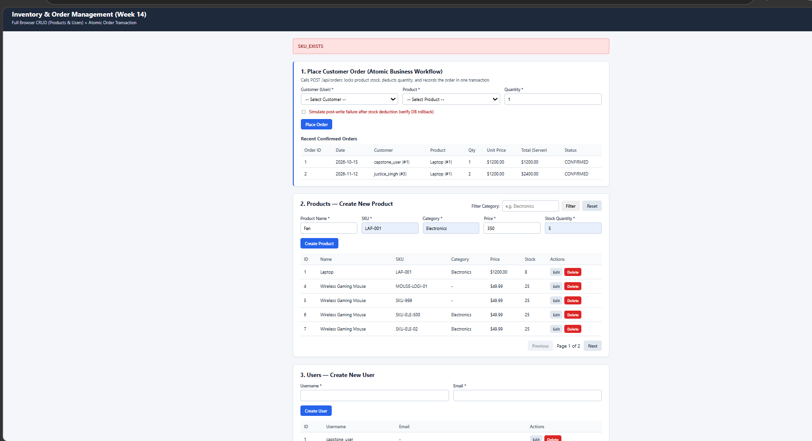
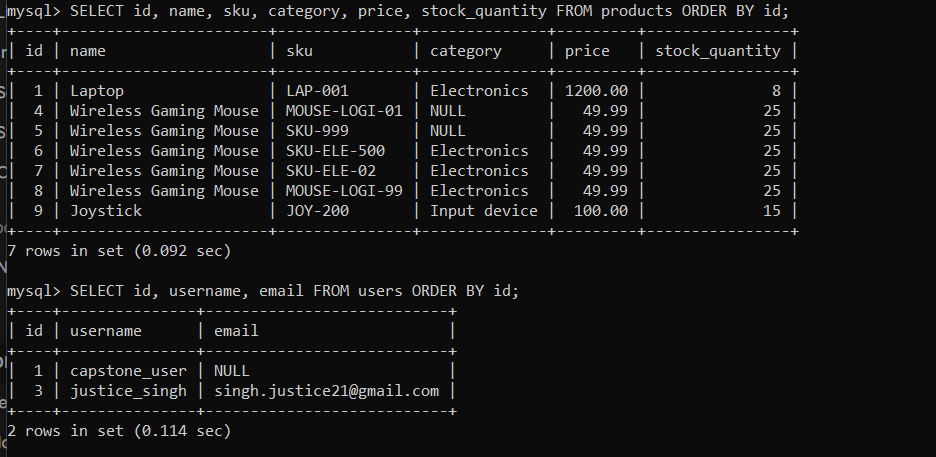
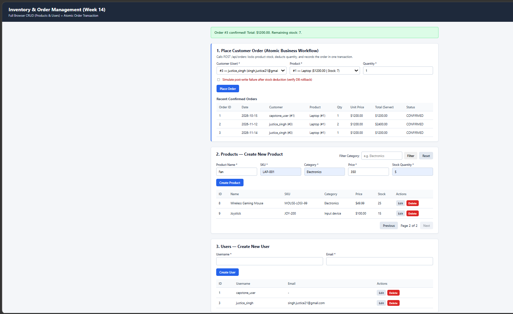
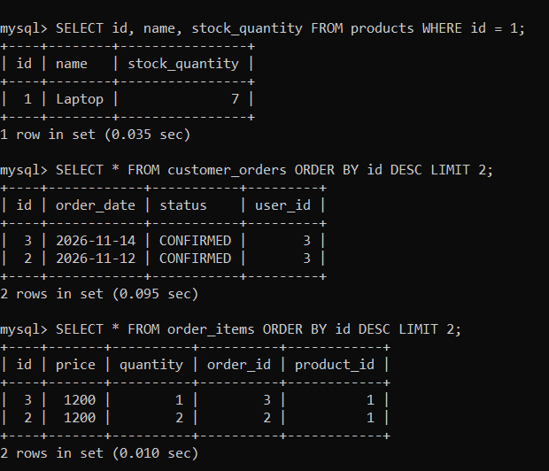
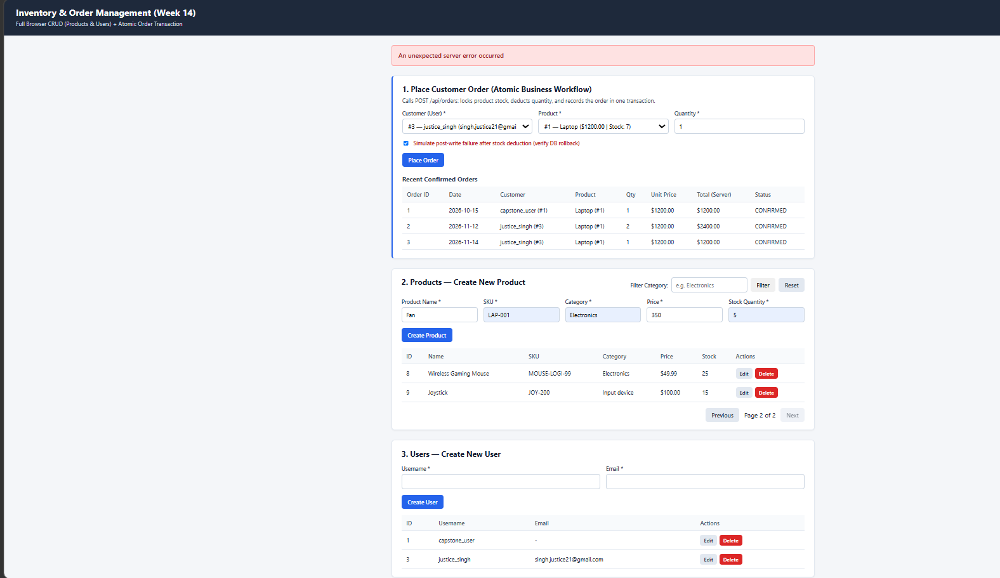
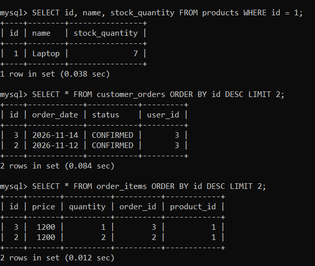
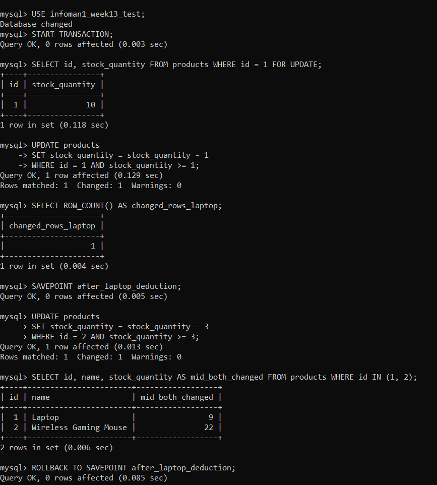
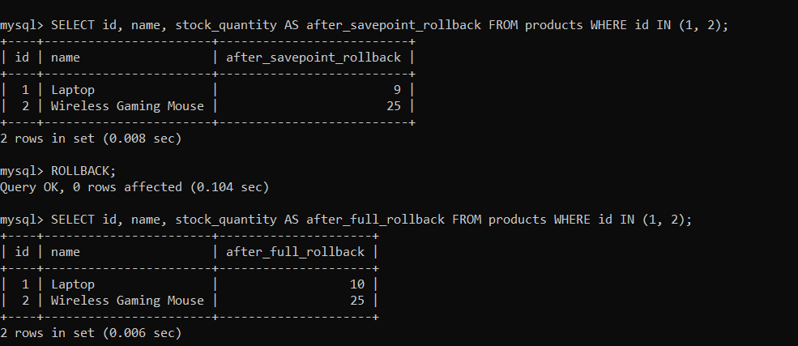

# INFOMAN1 — Week 14 Lab Answers

Name: OBIEFULE DECLAN  
Student ID: 2510223  
GitHub repo: https://github.com/sochimaobiefule-ship-it/infoman1  
Date submitted: 14/11/2026  

## Task 1 — Persisted Application CRUD & Validation (`Products` and `Users`)

**Approach / explanation:**
I implemented full Create, Read/Filter, Update, and Delete operations for two principal resources (`Products` and `Users`) in my Spring Boot (`webdev2`) application backed by MySQL InnoDB (`webdev2_week8`). Both forms bind parameters safely through Spring Data JPA / JDBC rather than string concatenation, look up records by primary key before updating or deleting, enforce `ON DELETE RESTRICT` so products or users tied to historical orders cannot be deleted, and reject invalid or duplicate inputs such as an existing SKU (`SKU_EXISTS`).

**Code / query used (if applicable):**
```sql
mysql> SELECT id, name, sku, category, price, stock_quantity FROM products ORDER BY id;

mysql> SELECT id, username, email FROM users ORDER BY id;
```

**Evidence (screenshot filename, output, or file reference in this folder):**








---

## Task 2 — Transaction Boundary & Successful Multi-Record Commit

**Approach / explanation:**
To enforce the business invariant that `stock_quantity` never drops below `0` and every stock deduction has a matching `customer_orders` and `order_items` record, I placed the order creation workflow inside a `public` `@Transactional` service method (`POST /api/orders`). When I submitted a valid order for `justice_singh` (`user_id = 3`) buying `1` `Laptop` (`product_id = 1`), Spring Boot locked the product row, deducted stock from `8` to `7`, and committed both the order header and line item (`Order #3`) atomically.

**Code / query used (if applicable):**
```sql
mysql> SELECT id, name, stock_quantity FROM products WHERE id = 1;

mysql> SELECT * FROM customer_orders ORDER BY id DESC LIMIT 2;

mysql> SELECT * FROM order_items ORDER BY id DESC LIMIT 2;
```

**Evidence (screenshot filename, output, or file reference in this folder):**




---

## Task 3 — Controlled Post-Write Failure & Full Rollback

**Approach / explanation:**
To prove atomicity when an error happens *after* the first database write, I enabled the UI's *"Simulate post-write failure after stock deduction"* flag and submitted another order for `Laptop`. The service deducted stock inside the active transaction and then threw an uncaught runtime exception before completing the method, causing Spring's transaction proxy to issue a `ROLLBACK` so `Laptop` stayed at `7` and no partial `Order #4` was persisted.

**Code / query used (if applicable):**
```sql
mysql> SELECT id, name, stock_quantity FROM products WHERE id = 1;

mysql> SELECT * FROM customer_orders ORDER BY id DESC LIMIT 2;

mysql> SELECT * FROM order_items ORDER BY id DESC LIMIT 2;
```

**Evidence (screenshot filename, output, or file reference in this folder):**




---

## Task 4 — SQL Transaction, Savepoint Partial Rollback vs. Full Rollback

**Approach / explanation:**
In my disposable `infoman1_week13_test` database (`transactions.sql`), I ran an explicit InnoDB transaction that locked `Laptop` (`id = 1`) with `SELECT ... FOR UPDATE`, deducted `1` unit (`10 -> 9`), created `SAVEPOINT after_laptop_deduction`, and then deducted `3` units from `Wireless Gaming Mouse` (`25 -> 22`). Running `ROLLBACK TO SAVEPOINT after_laptop_deduction` undid only the mouse deduction (`22 -> 25`) while keeping `Laptop` at `9`, and running a final `ROLLBACK` undid the entire transaction back to `Laptop = 10` and `Mouse = 25`.

**Code / query used (if applicable):**
```sql
mysql> START TRANSACTION;

mysql> SELECT id, stock_quantity FROM products WHERE id = 1 FOR UPDATE;

mysql> UPDATE products 
    -> SET stock_quantity = stock_quantity - 1 
    -> WHERE id = 1 AND stock_quantity >= 1;

mysql> SAVEPOINT after_laptop_deduction;

mysql> UPDATE products 
    -> SET stock_quantity = stock_quantity - 3 
    -> WHERE id = 2 AND stock_quantity >= 3;

mysql> ROLLBACK TO SAVEPOINT after_laptop_deduction;

mysql> ROLLBACK;
```

**Evidence (screenshot filename, output, or file reference in this folder):**




---

## Self-Check

* [] All tasks committed with individual, meaningful commit messages
* [] All files placed inside `infoman1/week14/`
* [] Repository link pasted into Moodle (no files uploaded)