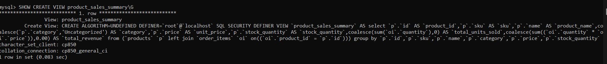
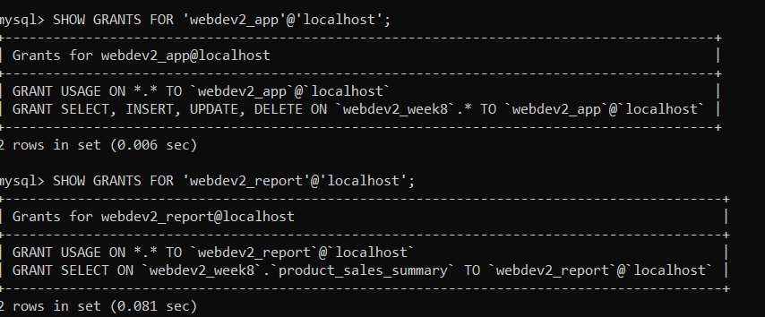
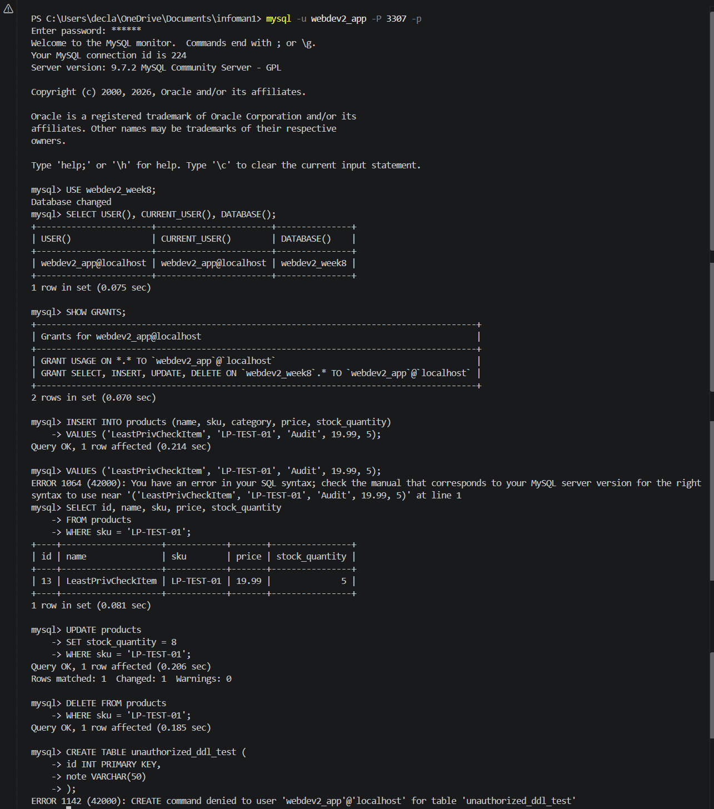
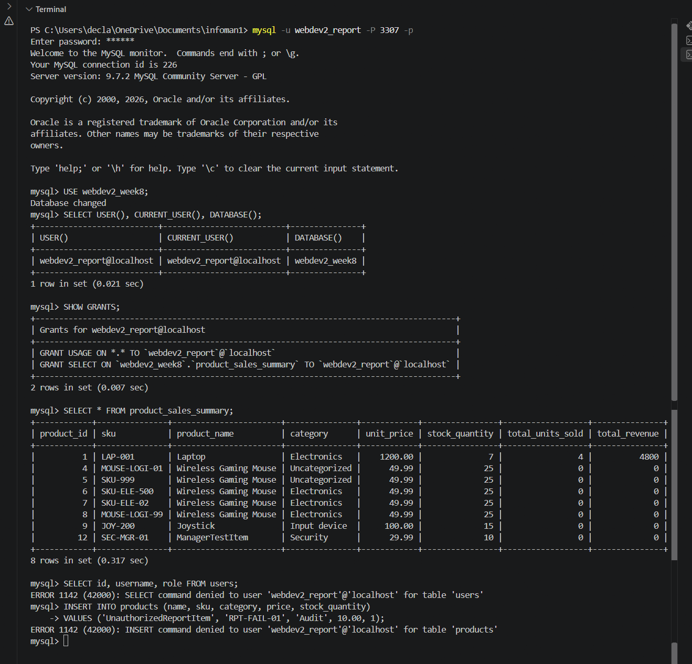
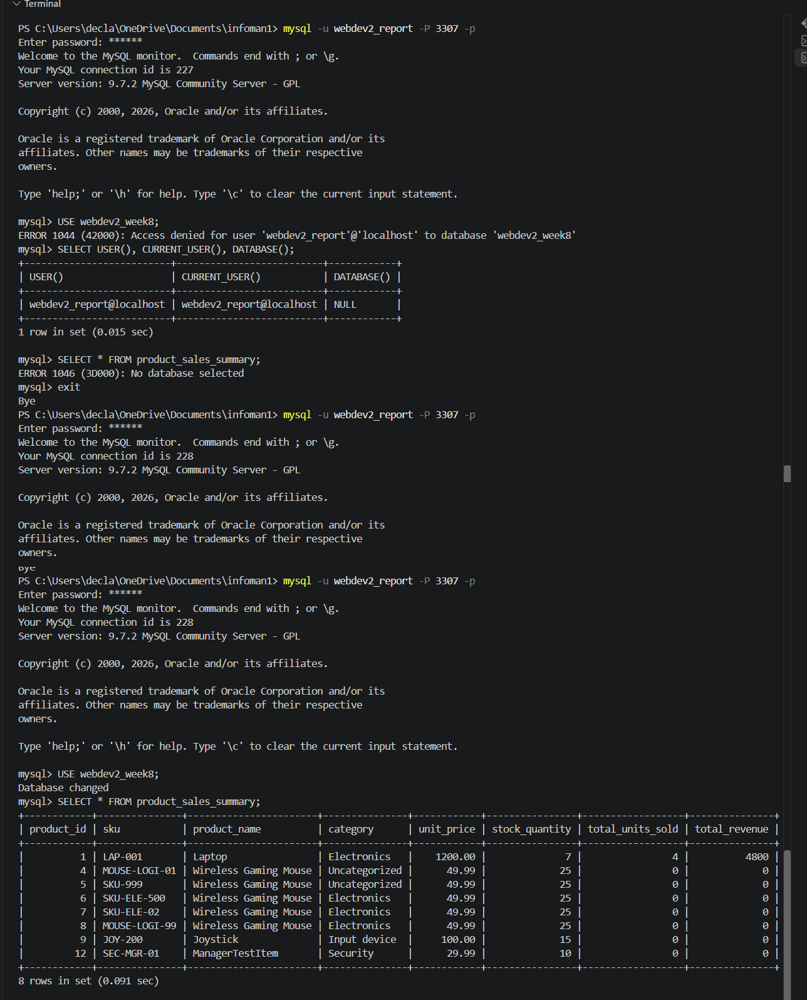

# INFOMAN1 Week 15 — Verification Checkpoint

**Name:** OBIEFULE DECLAN  
**Student ID:** 2510223  
**Date:** 18/11/2026  

## 1. View & Grant Setup (`root@localhost`)
* **View Check (`SHOW CREATE VIEW product_sales_summary\G`):** Confirmed the view is created with `DEFINER='root'@'localhost'` and `SQL SECURITY DEFINER`, joining `products` and `order_items`.

* **Grant Check (`SHOW GRANTS`):**
  * `webdev2_app@localhost` has only `GRANT SELECT, INSERT, UPDATE, DELETE ON webdev2_week8.*`.
  * `webdev2_report@localhost` has only `GRANT SELECT ON webdev2_week8.product_sales_summary`.

## 2. Runtime Application Account Tests (`webdev2_app@localhost`)
* **Session Check:** Connected on port `3307` (Connection ID `224`) and confirmed `USER()` and `CURRENT_USER()` both returned `webdev2_app@localhost` on `webdev2_week8`.
* **Allowed CRUD Test (`products`):**
  * `INSERT` test item (`LP-TEST-01`) -> `Query OK, 1 row affected`
  * `SELECT` test item (`LP-TEST-01`) -> Returned row (`id = 13`)
  * `UPDATE` stock quantity to `8` -> `Query OK, 1 row affected`
  * `DELETE` test item (`LP-TEST-01`) -> `Query OK, 1 row affected`
* **Denied DDL Test:**
  * Running `CREATE TABLE unauthorized_ddl_test (...)` failed with `ERROR 1142 (42000): CREATE command denied to user 'webdev2_app'@'localhost' for table 'unauthorized_ddl_test'`.
* **Spring Boot Integration Check:** Updated `application.properties` to `spring.jpa.hibernate.ddl-auto=validate` and ran `./mvnw spring-boot:run` with `DB_USERNAME=webdev2_app`. The application started cleanly (`Started Webdev2Application in 5.438 seconds`) without DDL privileges.

## 3. Read-Only Reporting Account Tests (`webdev2_report@localhost`)
* **Session Check:** Connected on port `3307` (Connection ID `226`) and confirmed `USER()` and `CURRENT_USER()` both returned `webdev2_report@localhost`.
* **Allowed View Query:**
  * `SELECT * FROM product_sales_summary;` succeeded and returned 8 aggregated product rows.
* **Denied Table Read & Write:**
  * `SELECT id, username, role FROM users;` failed with `ERROR 1142 (42000): SELECT command denied to user 'webdev2_report'@'localhost' for table 'users'`.
  * `INSERT INTO products (...)` failed with `ERROR 1142 (42000): INSERT command denied to user 'webdev2_report'@'localhost' for table 'products'`.

## 4. `REVOKE` and Restore Test
* **After `REVOKE SELECT` (Connection ID `227`):** Reconnecting as `webdev2_report@localhost` and running `USE webdev2_week8;` immediately failed with `ERROR 1044 (42000): Access denied for user 'webdev2_report'@'localhost' to database 'webdev2_week8'`.
* **After Restoring `GRANT SELECT` (Connection ID `228`):** Reconnecting as `webdev2_report@localhost` allowed `USE webdev2_week8;` and `SELECT * FROM product_sales_summary;` to succeed again, returning all 8 rows.

