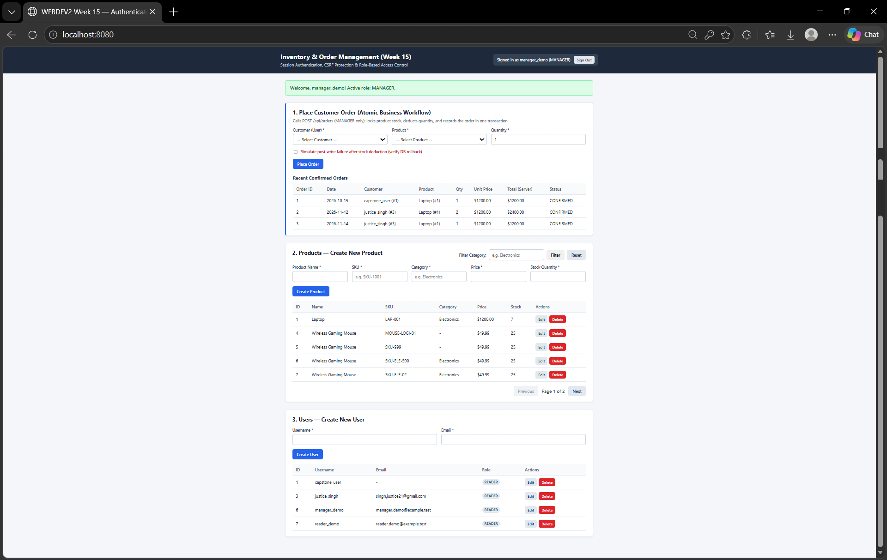
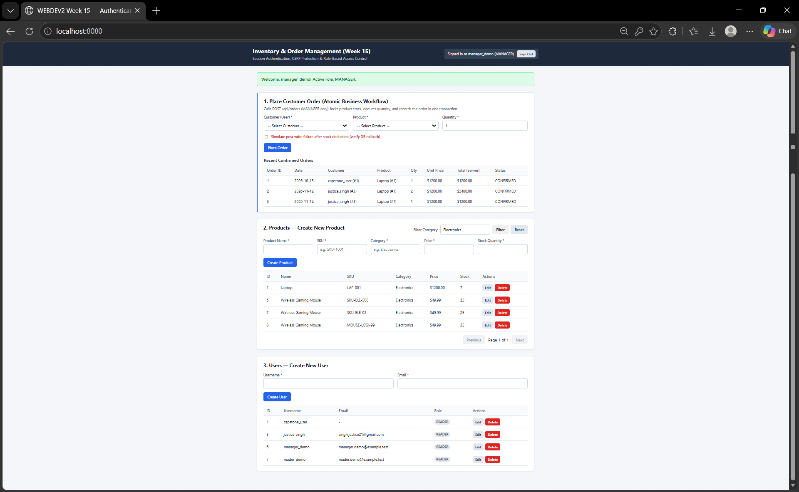
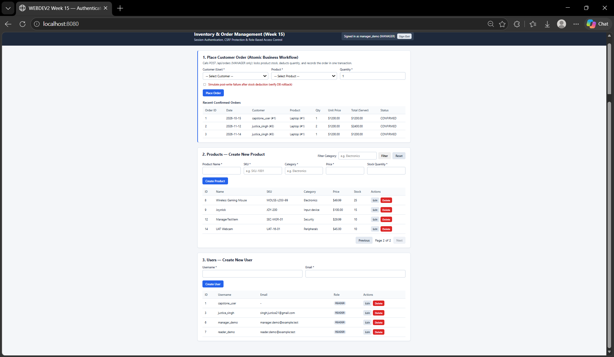
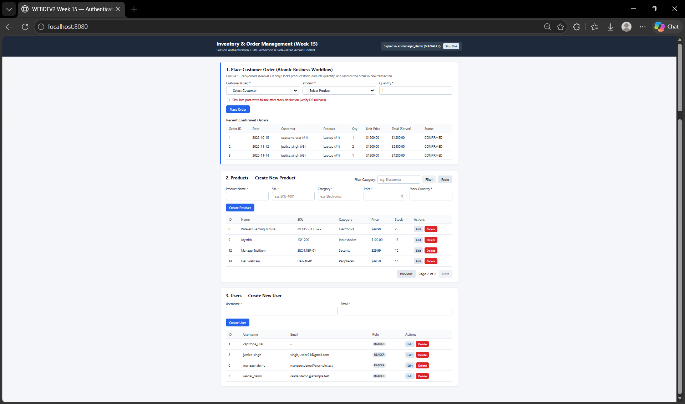
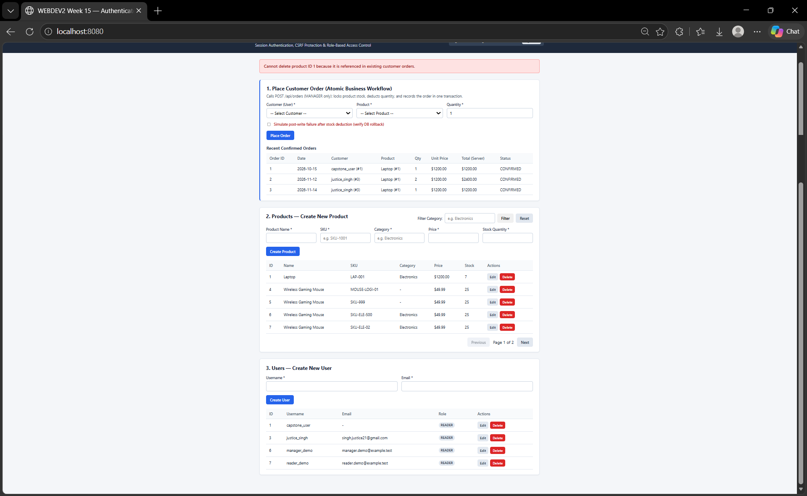
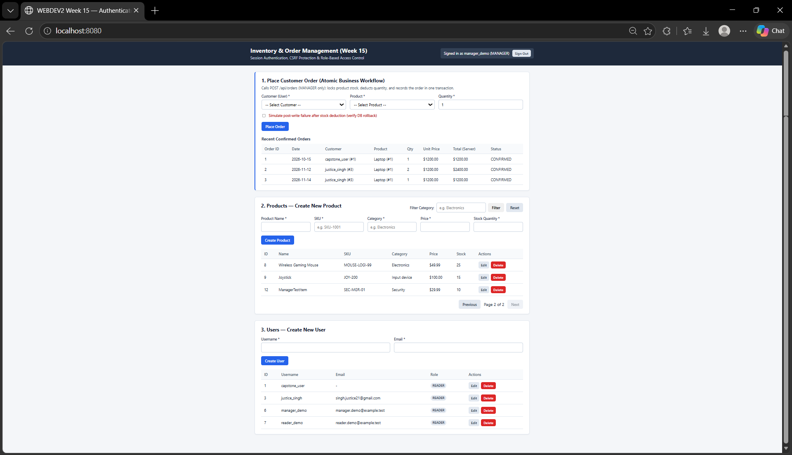
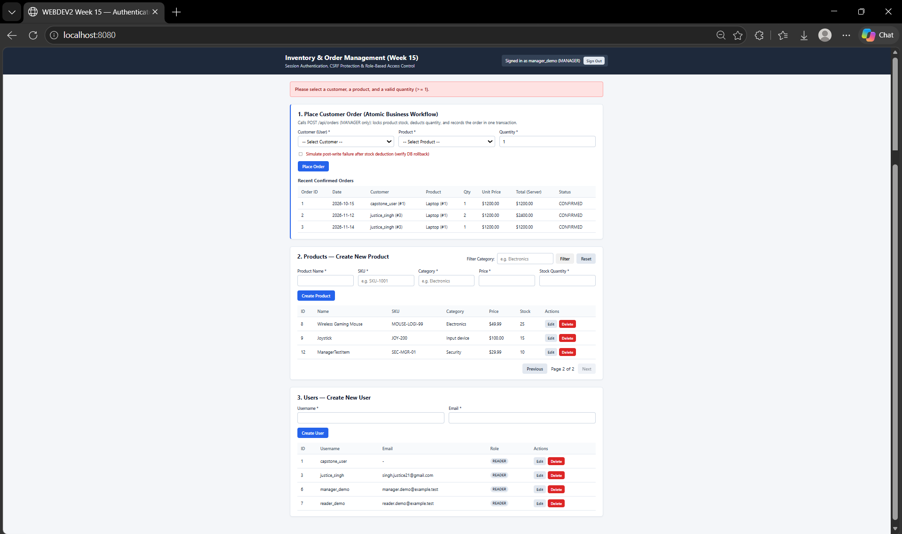
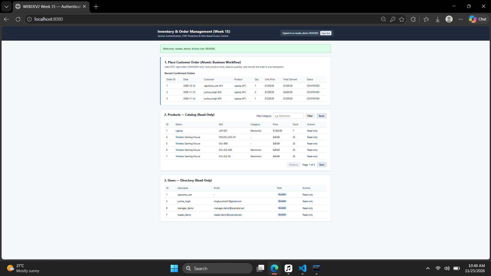
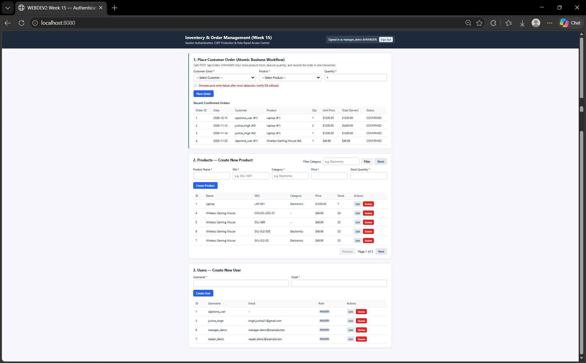
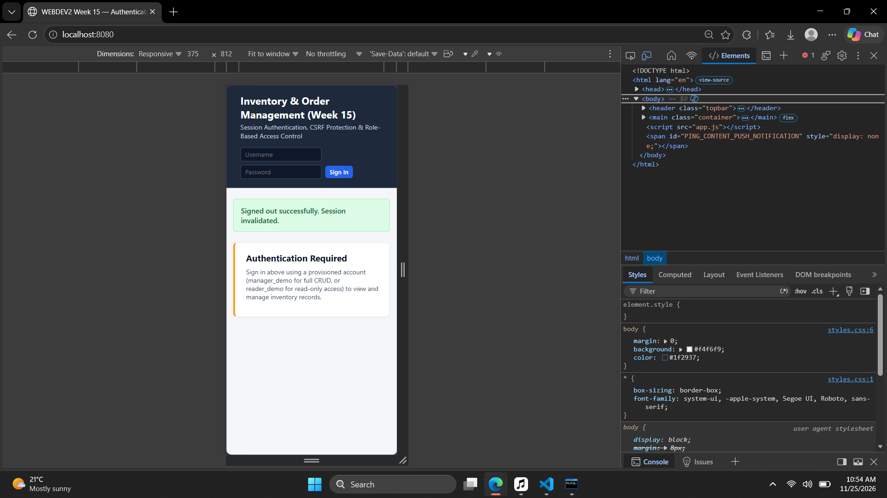

# INFOMAN1 Week 16 — Feature-Complete Database Integration Checkpoint (`checkpoint.md`)

**Student:** OBIEFULE DECLAN
**Student ID:** 2510223  
**Date:** 26/11/2026 
**Milestone:** F4 — Verified Database Integration (Feature-Complete Checkpoint)  
**Course Outcomes:** CO2 / CO3

---

## 1. Repository Paths, Branch & Environment Setup

* **INFOMAN1 Repository:** `https://github.com/sochimaobiefule-ship-it/infoman1/tree/main/week16`
* **Integrated Application Repository (`webdev2`):** `https://github.com/sochimaobiefule-ship-it/webdev2/tree/week16` (local path: `..\webdev2`, branch: `week16`)
* **Application Stack:** Spring Boot `3.2.3`, Java `21.0.8`, Maven Wrapper (`.\mvnw.cmd`), Spring Data JPA / Hibernate, Spring Security
* **MySQL Version & Port:** MySQL Server `8.0` running on `localhost:3307`
  * **Runtime Database:** `webdev2_week8`
  * **Isolated Test Database:** `webdev2_week16_test`
* **MySQL Accounts Verified (`week15/access_control.sql` & `week16/verification.sql`):**
  * `'webdev2_app'@'localhost'` — DML-only (`SELECT, INSERT, UPDATE, DELETE`) on `webdev2_week8.*` (no DDL privileges in runtime)
  * `'webdev2_report'@'localhost'` — Read-only (`SELECT`) restricted solely to `webdev2_week8.product_sales_summary`

---

## 2. Feature-Complete Requirement Checklist

- [x] **End-to-End CRUD & MySQL Persistence:** Creating, filtering/paginating, updating, and deleting products persist properly in MySQL across full browser reloads (`TC-01` – `TC-04`).
- [x] **Database Constraint & Foreign Key Enforcement:** Duplicate unique SKU (`ERROR 1062`), invalid foreign key (`ERROR 1452`), and restricted parent deletion (`ERROR 1451` / HTTP `409`) verified directly against MySQL (`TC-05`, `TC-07`, `TC-08`).
- [x] **Reporting Views & Expected Totals:** `product_sales_summary` (`LEFT JOIN` + `COALESCE`) and `order_summary_view` matched hand-calculated totals, including unsold Product `103` (`0` units, `0` revenue) and empty-result lookup `id = 999999` (`TC-09`, `TC-10`).
- [x] **Atomic Transactions & Rollback Verification:** Order commit (`COMMIT`, Product `103` stock `15 -> 13`) and post-write failure rollback (`ROLLBACK` after `ERROR 1452`, stock kept at `13` and order `504` count `0`) verified in MySQL and JUnit (`TC-11`, `TC-12`).
- [x] **Least-Privilege Access & Role Security:** `SHOW GRANTS` confirmed restricted privileges for `webdev2_app` and `webdev2_report` (`TC-13`, `TC-14`); Spring Security `MANAGER` vs. `READER` and CSRF rules verified via `Week16ApiSecurityTests` (`6/6`) and `UAT-07`.
- [x] **Defect Resolution & Regression Reruns:** Fixed `DEF-001` (`UserResponseDTO` / `UserService` role mapping) and `DEF-002` (`APP_SEED_READER_PASSWORD` session seeding) and confirmed `13/13` automated tests pass with zero regressions.

---

## 3. Verified Test Outputs

### A. Automated Test Suite (`.\mvnw.cmd test` on `webdev2_week16_test`)
* `Week16MySqlTransactionTests`: **2 / 2 passed**
* `Week16ApiSecurityTests`: **6 / 6 passed**
* `Week16ServiceUnitTests`: **4 / 4 passed**
* `Webdev2ApplicationTests`: **1 / 1 passed**
* **Result:** **13 / 13 passed** (`0` failures, `0` errors, `0` skipped — `BUILD SUCCESS`)

### B. MySQL Verification Script (`week16/verification.sql` on `webdev2_week16_test`)
* **`product_sales_summary` Output:**
  ```text
  +------------+-------------+----------------+-------------+------------+----------------+------------------+---------------+
  | product_id | sku         | product_name   | category    | unit_price | stock_quantity | total_units_sold | total_revenue |
  +------------+-------------+----------------+-------------+------------+----------------+------------------+---------------+
  |        101 | TEST-LAP-01 | Test Laptop    | Electronics |    1000.00 |             10 |                2 |          2000 |
  |        102 | TEST-MSE-02 | Test Mouse     | Electronics |      50.00 |             20 |                4 |           200 |
  |        103 | TEST-USB-03 | Unsold USB Hub | Accessories |      25.00 |             15 |                0 |             0 |
  +------------+-------------+----------------+-------------+------------+----------------+------------------+---------------+

* **Deliberate Constraint Checks:** Rejected duplicate SKU `'TEST-LAP-01'` (`ERROR 1062`), invalid `user_id = 9999` (`ERROR 1452`), and parent delete on `product_id = 101` (`ERROR 1451`).
* **Transaction Rollback Check:** Product `103` stock stayed at `13` and `rolled_back_order_count = 0` after `ERROR 1452` + `ROLLBACK`.
* **Raw Terminal Log:** Saved in [evidence/verification_output.txt](evidence/verification_output.txt).

### C. UAT & Evidence Screenshots (`week16/evidence/`)

* **Raw MySQL Terminal Log:** [evidence/verification_output.txt](evidence/verification_output.txt)

#### 1. Authenticated Manager Session (`uat-01-manager-login-session.png`)


#### 2. Category Filter, Reset & Pagination (`uat-02-filter-pagination.png`)


#### 3. Product Create & Update Persistence (`uat-03-create-product.png`, `uat-04-update-product.png`)



#### 4. Delete Conflict Protection vs. Clean Delete (`uat-05-delete-conflict.png`, `uat-05-delete-success.png`)



#### 5. Clean Validation Alert (`uat-06-validation-error.png`)


#### 6. Read-Only Reader Session (`uat-07-reader-readonly.png`)


#### 7. Order Transaction Commit & Mobile Layout (`uat-08-order-transaction.png`, `uat-08-mobile-keyboard.png`)



---

## 4. Remaining Limitations & Known Operational Notes

1. **Single-Item UI Checkout Form:** The current frontend order form submits one product line item per request (`customer_orders` + `order_items`), though the relational schema supports multi-item orders (`1:N`) as verified in `verification.sql` (Order `501` with 2 items).
2. **Session-Scoped Environment Variables:** Database credentials (`DB_PASSWORD`) and demo seed passwords (`APP_SEED_MANAGER_PASSWORD`, `APP_SEED_READER_PASSWORD`) are intentionally kept out of `application.properties` and must be set in each new PowerShell session before starting Spring Boot.
3. **Future Scale-Up Index Candidate:** `EXPLAIN` confirmed `customer_orders` currently scans 3 rows and filesorts `ORDER BY order_date DESC`; adding `CREATE INDEX idx_orders_status_date ON customer_orders (status, order_date);` is documented in `lecture.md` as the next schema migration when order volume grows.